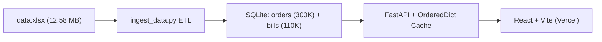

<div align="center">


<h2>California Burrito — Business Analytics Dashboard</h2>

<p>
  Interactive restaurant POS analytics across <strong>300,000 line items</strong>, <strong>110,478 unique orders</strong>, and <strong>6 Bangalore stores</strong>.
</p>

<p>
  <a href="https://california-burrito-analytics-six.vercel.app/"><strong>Launch Live Dashboard ↗</strong></a>
  &nbsp;&nbsp;•&nbsp;&nbsp;
  <strong>React 18 · TypeScript · Tailwind · FastAPI · SQLite</strong>
</p>

</div>

---

## Snapshot (`Jun 2025 – Jun 2026`)

| Unique Orders (`BillNo`) | Total Revenue | Items Sold | Network Coverage |
| :--- | :--- | :--- | :--- |
| **110,478** *(300,000 rows)* | **₹6.95 Cr** *(₹628.91 AOV)* | **434,448** *(3.93 / order)* | **6 Stores · 7 Categories · 45 Items** |

---

## Architecture & Key Decisions



- **Two-Table Query Routing:** Store, channel, payment, and overall trends query the pre-aggregated `bills` table (`110,478` rows); `category` filters route to `orders` (`300,000` rows) using `COUNT(DISTINCT bill_no)` to prevent duplicate-row inflation.
- **Measured Speedup:** Replacing cold Excel parses (`48,556 ms`) with **11 SQLite B-tree indexes** (`mmap_size=256MB`, `temp_store=MEMORY`) and a 256-entry `OrderedDict` cache delivers **69.59–516.08 ms** uncached and **0.007–0.022 ms** cached responses (**2–15 ms** HTTP).
- **Security & Parity:** Parameterized SQL queries, `YYYY-MM-DD` validation, GZip compression, origin-restricted CORS (`https://california-burrito-analytics-six.vercel.app`), formula-safe CSV exports (`5,000`-row cap), and **0** Pandas parity discrepancies.

---

## Implemented Views

- **Overview:** 6 KPI cards, dynamic Key Business Highlights strip, and 7 charts with daily/weekly/monthly toggles.
- **Sales Trends:** Revenue curves alongside weekday and hourly rush (`11 AM – 11 PM`) demand patterns.
- **Menu & Items:** Top 5 & bottom 5 sellers plus searchable table across all 45 items (retaining `₹0` dips).
- **Store Performance:** Interactive store selector synced with global filters and per-store drilldowns.
- **Orders & Receipts:** Paginated order history (`20`/page), live search, CSV export, and itemized bill modal.
- **Responsive UI:** Collapsible desktop sidebar, mobile slide-over drawer (`< 768px`), and removable filter chips.

---

## Run & Deploy

- **Windows One-Click:** Double-click **[start.bat](start.bat)** to initialize the DB and open **`http://127.0.0.1:3000`**.
- **Hosted Stack:** Frontend on **Vercel** ([live app](https://california-burrito-analytics-six.vercel.app/)) · FastAPI backend on **Render** (`california-burrito-api.onrender.com`, blueprint in [render.yaml](render.yaml)).

<details>
<summary><strong>Manual Setup, Tests & Verification Results</strong></summary>

```bash
# Backend (http://127.0.0.1:8000)
pip install -r backend/requirements.txt
python backend/scripts/ingest_data.py
python -m uvicorn app.main:app --app-dir backend --host 127.0.0.1 --port 8000

# Frontend (http://localhost:3000)
cd frontend && npm install && npm run dev

# Tests & Build
python -m unittest discover backend/tests -v
npm --prefix frontend run build
```

- **Backend Suite:** `8 / 8` regression tests passed (`4.066s`).
- **Parity Audits:** `0` discrepancies against [data.xlsx](data.xlsx) across unfiltered, category (`Burgers`: `70,603` orders), and multi-filter slices.
- **Frontend Build & QA:** `tsc && vite build` passed (`5.13s`); verified on desktop (`1440×900`), tablet (`768×1024`), and mobile (`375×812`) with `0` console errors and `0` HTTP `4xx/5xx` responses.

</details>

---

## Trade-Offs & Limitations

- **Build-Time SQLite:** Bundling/rebuilding [data/analytics.db](data/analytics.db) (`93.89 MB`) removes runtime Excel ingestion on Render's ephemeral free disk without paid storage, assuming a static dataset.
- **Free-Tier Constraints:** Render Free services sleep after inactivity (first request after idle wakes the container), and `/api/export` bounds downloads to `5,000` orders per request.
- **Worker-Local Cache & Bundle Size:** The 256-entry `OrderedDict` cache targets a single Uvicorn worker; the minified JS bundle (`671.22 kB` / `180.54 kB` gzip) can be code-split further if new modules are added.
