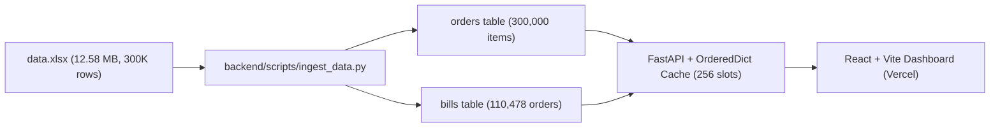

<div align="center">


<h1>California Burrito — Business Analytics Dashboard</h1>

<p>
  Full-stack restaurant analytics platform transforming <strong>300,000 POS line items</strong> across <strong>110,478 unique customer orders</strong> into fast, accurate business insights.
</p>

<p>
  <a href="https://california-burrito-analytics-six.vercel.app/"><strong>Live Dashboard ↗</strong></a>
  &nbsp;&nbsp;•&nbsp;&nbsp;
  <a href="https://california-burrito-api.onrender.com/api/health"><strong>Live API Health ↗</strong></a>
  &nbsp;&nbsp;•&nbsp;&nbsp;
  <strong>React 18 · TypeScript · FastAPI · SQLite</strong>
</p>

</div>

---

## Key Verified Metrics (`Jun 2025 – Jun 2026`)

| Metric | Value | Calculation Basis |
| :--- | :--- | :--- |
| **Total Line Items** | **300,000** | Complete row count from [data.xlsx](data.xlsx) |
| **Unique Orders** | **110,478** | `COUNT(DISTINCT bill_no)` — never counted from raw rows |
| **Total Sales** | **₹69,480,952.00** (`₹6.95 Cr`) | `SUM(price * quantity)` |
| **Items Sold** | **434,448** | `SUM(quantity)` |
| **Avg Order Value** | **₹628.91** (`3.93` items/order) | `Total Revenue ÷ Unique Orders` |
| **Scope** | **6 Bangalore Stores · 7 Categories · 45 Items** | Koramangala led at `24.03%`; Burgers led categories at `38.73%` |

---

## Architecture & Data Pipeline

Instead of re-parsing a 12.58 MB `.xlsx` file per request (~48.6s cold Excel read), an idempotent ETL pipeline builds a read-optimized SQLite analytical store at build time with two-table query routing:



### Core Engineering Decisions
- **Two-Table Routing (`orders` + `bills`):** Queries without a `category` filter read the deduplicated 110,478-row `bills` header table directly. When a `category` filter is active, queries switch to `orders` and evaluate `COUNT(DISTINCT bill_no)` accurately (e.g., `70,603` Burgers bills).
- **11 B-Tree Indexes + Analytical PRAGMAs:** `7` indexes on `orders`, `4` on `bills`, alongside `mmap_size = 268435456` (256 MB), `temp_store = MEMORY`, and `cache_size = -64000` (64 MB).
- **Thread-Safe In-Memory Cache & Compression:** Normalized filter tuples cache results in a lock-guarded `OrderedDict` (up to 256 entries), paired with `GZipMiddleware(minimum_size=1024)`.
- **Security Hardening:** Parameterized `?` SQL queries everywhere, strict `YYYY-MM-DD` validation (`HTTP 422`), inverted range guard (`HTTP 400`), `CORS_ORIGINS` allow-listing, sanitized HTTP `500` errors, `contextlib.closing` connection cleanup, and CSV formula escaping (`=`, `+`, `-`, `@`, `\t`, `\r`).

---

## Measured Performance Benchmarks

Measured against the workspace database (`93.89 MB` `analytics.db` built from `12.58 MB` `data.xlsx`):

| Query Path | Measured Latency | Notes |
| :--- | :--- | :--- |
| **Raw Excel Scan** (`pandas.read_excel`) | **48,556.26 ms** | Unindexed file load baseline |
| **SQLite Cold Uncached** (`_QUERY_CACHE` cleared) | **69.59 – 516.08 ms** | Daily trend `69.59 ms`; full summary `516.08 ms`; 3-filter slice `112.29 ms` |
| **Warm `OrderedDict` Cache** (Python / HTTP) | **0.007 – 0.022 ms** / **1.98 – 15.25 ms** | Near-instant repeat filter reads |
| **Filtered CSV Export** (`/api/export`, `5,000` rows) | **490.72 – 551.28 ms** | Streaming UTF-8-SIG download |

---

## Dashboard Views & Features

- **Overview:** 6 animated KPI cards, collapsible dynamic **Key Business Highlights**, and 7 responsive charts (daily/weekly/monthly toggle re-fetches only the trend endpoint; Orders Over Time derives via `useMemo`).
- **Sales Trends:** Granular revenue timelines, weekday seasonality, hourly rush patterns (`11 AM – 11 PM`), store, order-type (`Dine-In ₹3.14 Cr`, `Delivery ₹2.41 Cr`, `Takeaway ₹1.40 Cr`), and payment mix.
- **Menu & Items:** Top 5 & bottom 5 performers plus a debounced searchable (`220 ms`) table of all 45 menu items (preserving complimentary `₹0` condiments across `8,611` line items).
- **Store Performance:** Interactive store selector pills automatically synced to global store filters, with per-store category, order-type, and hourly drilldowns.
- **Orders & Receipts:** Paginated order browser (`20` rows/page), `250 ms` debounced search, formula-safe CSV export, and a viewport-centered Receipt Details modal (`Copy` feedback + `Esc` close).
- **Responsive Design:** Classic collapsible forest-green desktop sidebar with smooth active-pill indicator, responsive tablet KPI cards, and an off-canvas mobile drawer (`< 768px`).

---

## Verification & Test Summary

| Check | Outcome | Scope Verified |
| :--- | :--- | :--- |
| **Backend Regression Suite** (`python -m unittest discover backend/tests -v`) | **8 / 8 passed (`4.066s`)** | Exact KPI math, all endpoints, outlet sync, `/orders` & `/export` category filtering, `422`/`400`/`404` errors, SQL injection parameterization |
| **Pandas Parity Audits** (`audit_data.py`, `audit_deep.py`) | **0 discrepancies** | Unfiltered, category-filtered, product search, weekly/monthly trends, and multi-filter slices vs `data.xlsx` |
| **Frontend Production Build** (`npm --prefix frontend run build`) | **Passed (`5.13s`)** | TypeScript + Vite bundle (`dist/assets/index-DFrnkNV7.js` `671.22 kB` / `180.54 kB` gzip) |
| **Cross-Viewport Browser QA** (`1440×900`, `768×1024`, `375×812`) | **0 console errors · 0 4xx/5xx** | Verified locally and live on Vercel across all 5 tabs, combined filters, tooltips, search, pagination, modals, and CSV export |

---

## Quick Start & Cloud Deployment

### Run Locally (Windows)
Double-click **[start.bat](start.bat)** to initialize `data/analytics.db` (if needed), start FastAPI (`127.0.0.1:8000`), launch Vite (`127.0.0.1:3000`), and open the app.

<details>
<summary><strong>Manual Setup, Test Commands & Cloud Deployment (Render + Vercel)</strong></summary>

#### Manual Two-Terminal Setup
```bash
# Backend (http://127.0.0.1:8000)
pip install -r backend/requirements.txt
python backend/scripts/ingest_data.py
python -m uvicorn app.main:app --app-dir backend --host 127.0.0.1 --port 8000

# Frontend (http://localhost:3000)
cd frontend
npm install
npm run dev
```

#### Verification Commands
```bash
python -m unittest discover backend/tests -v
npm --prefix frontend run build
```

#### Cloud Deployment Configuration
- **Backend — Render ([render.yaml](render.yaml)):**
  - Build: `pip install -r backend/requirements.txt && python backend/scripts/ingest_data.py`
  - Start: `python -m uvicorn app.main:app --app-dir backend --host 0.0.0.0 --port $PORT`
  - Env: `PYTHON_VERSION=3.11.9`, `CORS_ORIGINS=https://california-burrito-analytics-six.vercel.app`
- **Frontend — Vercel ([frontend/vercel.json](frontend/vercel.json)):**
  - Root Directory: `frontend` · Build: `npm run build` · Output: `dist`
  - Env: `VITE_API_URL=https://california-burrito-api.onrender.com`

</details>

<details>
<summary><strong>Project Structure & REST API Reference (17 Endpoints)</strong></summary>

```text
california-burrito-analytics/
├── backend/
│   ├── app/
│   │   ├── api/endpoints.py            # 17 REST routes (/ to /api/export)
│   │   ├── database/connection.py      # Read-optimized SQLite PRAGMAs
│   │   ├── schemas/analytics.py        # Pydantic models & FilterParams
│   │   ├── services/analytics_service.py # Two-table query router + OrderedDict cache
│   │   └── main.py                     # FastAPI app, CORS, GZip, global error handler
│   ├── scripts/ingest_data.py          # Idempotent Pandas -> SQLite ETL
│   └── tests/test_api.py               # Automated regression tests (8 cases)
├── frontend/src/
│   ├── components/                     # Sidebar, TopNav, FilterBar, KPICard, ChartTooltip, OrderDetailsModal
│   ├── layouts/DashboardLayout.tsx     # Responsive sidebar & mobile drawer shell
│   ├── pages/                          # Overview, Sales Trends, Menu & Items, Store Performance, Orders & Receipts
│   └── services/api.ts                 # Fetch wrapper with AbortSignal support
├── data/analytics.db                   # Pre-built indexed SQLite database (93.89 MB)
├── data.xlsx                           # Source POS dataset (12.58 MB)
├── render.yaml
└── start.bat
```

| Endpoint | Purpose |
| :--- | :--- |
| `GET /`, `GET /api/health` | Root check & DB readiness (`300,000` records, `110,478` bills) |
| `GET /api/filters` | Distinct outlets, categories, order types, payments, `[min_date, max_date]` |
| `GET /api/dashboard/summary` | Core KPI metrics + top store/category/item |
| `GET /api/dashboard/revenue-trend`, `/orders-trend` | Daily, weekly, or monthly revenue & order series |
| `GET /api/dashboard/category-performance` | Revenue, quantity, unique orders & share per category |
| `GET /api/dashboard/order-type-distribution`, `/payment-distribution` | Channel and settlement splits |
| `GET /api/dashboard/top-products`, `/outlet-performance` | Ranked best sellers & outlet leaderboard |
| `GET /api/analytics/sales`, `/products`, `/outlets` | Extended page analytics, 45-item search & store drilldowns |
| `GET /api/orders`, `GET /api/orders/{bill_no}` | Paginated order list & full itemized bill lookup |
| `GET /api/export` | Streams formula-safe filtered CSV (`5,000`-row cap) |

</details>

---

## Trade-Offs & Limitations

1. **Build-Time SQLite Generation:** Generating/bundling `data/analytics.db` (`93.89 MB`) removes cold-start ETL overhead on Render's ephemeral disk without requiring paid block storage, fitting a static historical POS dataset.
2. **Free-Tier Constraints:** Render Free services spin down when idle, so the first request after inactivity takes extra time to wake; `/api/export` caps CSV streams at `5,000` rows per download to protect container memory.
3. **Worker-Local Cache & Bundle Size:** The 256-entry `OrderedDict` cache assumes a single Uvicorn worker matching SQLite's single-file model; Vite notes a `671.22 kB` JS chunk (`180.54 kB` gzipped) that can be split dynamically if more routes are added.
